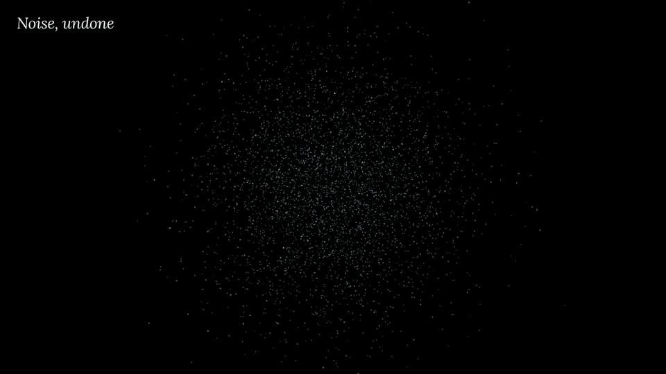

# Noise, undone

[](loop/noise-loop.mp4)

<sub>8-second loop. Click for the MP4 (1280×720, 2.2 MB); the GIF above is 960×540, 5.3 MB.</sub>

A tiny diffusion model, trained from scratch, running entirely in the browser. It starts with 4,000 points of pure Gaussian noise and moves them, step by step, into a trefoil knot. You watch it happen in 3D.

The third piece in a set: [micrograd 3D](https://github.com/joezgao/micrograd-3d) shows a network learning, [Attention, in space](https://github.com/joezgao/attention-in-space) shows a transformer reading, and this one shows a generative model creating, using the score-based / diffusion idea (Sohl-Dickstein et al. 2015, Song & Ermon 2019, Ho et al. 2020).

## Open it

Open `noise-undone.html` in a recent browser. It is a single 150 kB file; it needs an internet connection to load three.js and two fonts. If your browser blocks local files:

```bash
python3 -m http.server 8000   # then open http://localhost:8000/noise-undone.html
```

| Control | What it does |
|---|---|
| **Play / Pause** (<kbd>Space</kbd>) | runs the reverse process from t = 100 (noise) to t = 0 (knot) in about 8 s, at an even pace in log noise level, and settles gently into t = 0 |
| **Scrubber** (<kbd>←</kbd> <kbd>→</kbd>) | the same log-noise axis; ticks mark t = 100, 50, 20, 10, 5, 2, 0, and t = 10 sits mid-track, because the knot only becomes legible below t ≈ 15 |
| **Re-noise** (<kbd>R</kbd>) | runs the *forward* process until the knot is gone, then the model draws a new knot from that new noise |
| **Guess** (<kbd>G</kbd>) | for every point, the network's estimate of the clean point it came from, x̂₀ = (x_t − √(1−ᾱ_t) ε̂) / √ᾱ_t, drawn in the accent colour, with a faint line from one point in eight to its guess: the denoising direction (by Tweedie's formula, the learned score) |
| Drag / scroll / double-click | orbit / zoom / reset |

Points start grey and take on the cyan accent as the knot forms; each keeps a fading trail of its last 14 steps. Add `?ddpm` to the URL for the stochastic sampler (jittery Brownian paths instead of smooth curves). With `prefers-reduced-motion` there is no autoplay or camera drift, and the main button becomes **Step** (10 diffusion steps per press).

## The model

| | Value |
|---|---|
| Data | A trefoil knot, (sin s + 2 sin 2s, cos s − 2 cos 2s, −sin 3s) scaled by (0.5, 0.5, 0.8), thickened into a tube of radius 0.06; fresh samples every batch |
| Network ε_θ(x_t, t) | x plus sin/cos Fourier features at 6 frequencies (39 dims) and a sinusoidal time embedding (32 dims) → 3 hidden layers of 128 SiLU units (last two residual) → 3 outputs. **42,627 parameters** |
| Diffusion | DDPM, **T = 100**, cosine schedule (Nichol & Dhariwal) with β clipped at 0.25; simple MSE loss on the noise, t uniform |
| Sampler | DDIM (η = 0) on the page, deterministic and smooth; DDPM ancestral with `?ddpm` |
| Loss | Held-out MSE **0.2861** on 200k fresh draws, unchanged with the shipped fp16 weights. About 0.29 is the floor for this data: at large t the noise cannot be predicted |
| Quality | Distance from 4,000 samples to the knot's centre line, shipped weights: DDIM median 0.027, 99.6 % within 0.12; DDPM median 0.025, 99.9 % within 0.12 (real data: median 0.043). No dropped segment |
| Shipped weights | float16, base64-inlined (85 kB raw) |

**Training.** NumPy with a hand-written backward pass, checked against central finite differences in float64 (worst relative error 8.9e-9). Adam (0.9, 0.999), lr 2e-3 with a 500-step warmup and cosine decay to 5e-5, gradient-norm clipping at 1.0, batch 2,048, 40,000 steps, and an EMA of the weights (decay 0.999), which is what ships. 23 minutes on 2 CPU cores.

## How the page works

- One HTML file. three.js 0.147.0 loads from jsDelivr; Lora and Inter load from Google Fonts. Weights, network, samplers and shaders are inline.
- The network runs in plain JavaScript in up to 4 Web Workers, with the particles split across them. The time embedding enters only layer 1, so its contribution is precomputed once per step. Playback never outruns the workers; on a slow machine it moves smoothly, only more slowly.
- Every step is kept (101 × 4,000 × 3 floats), so the scrubber and trails read from a stored trajectory. Points are additive sprites; trails are one `LineSegments` buffer with per-vertex fade.

## Limits

- The data is one fixed 3D shape with no conditioning: a small, faithful DDPM, not a demonstration of scale.
- The loss alone says little about quality; the distance-to-knot numbers are the real check. About 0.4 % of DDIM samples land off the tube.
- Frame rate was not measured on a real GPU. Main-thread JavaScript is about 1 ms per frame; on a slow phone, computing the 100 steps is the bottleneck.
- A guess is not where a point ends up: x̂₀ is a posterior mean, averaged over every clean point that could have produced x_t. At t = 20 the points are still a cloud (median 0.36 from the knot) while their guesses already trace it (0.083).
- The knot forms late: under the cosine schedule the points only show it in roughly the last 10–15 of 100 steps. The log-noise axis gives those steps half the track, and Guess shows the knot already present in the network's predictions.

## In this repository

- `noise-undone.html`: the piece
- `screenshots/`: t = 100, t = 20, t = 0, the guesses, and a phone view

The NumPy training, gradient-check and export scripts are not in this repository yet.

## License

Code: MIT. See [LICENSE](LICENSE). three.js is MIT; the fonts are under the SIL Open Font License.

Built with Claude for Joe Gao.
